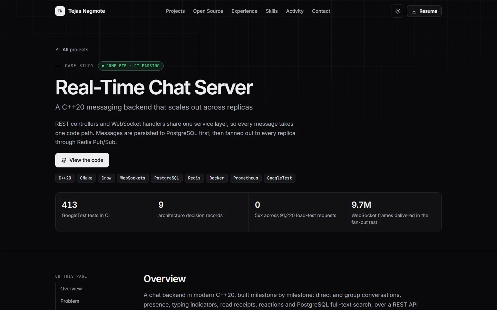
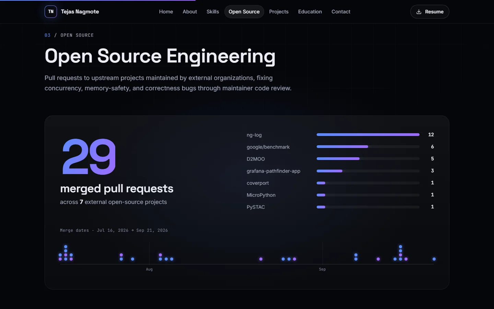
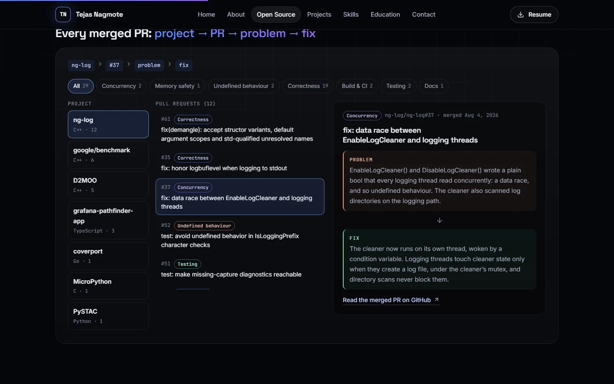
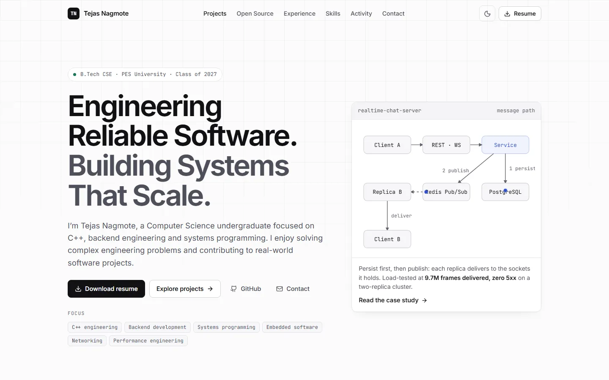
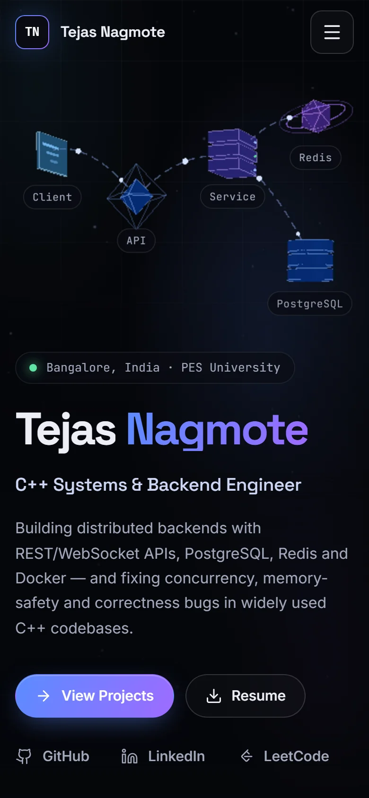
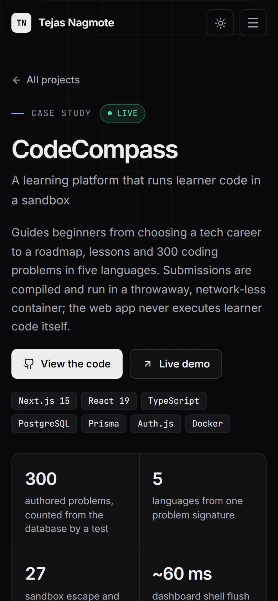

# Tejas Nagmote — Portfolio

Engineering portfolio of **Tejas Nagmote**, software engineer and Computer Science undergraduate
(B.Tech, PES University, 2027) focused on C++, backend engineering and systems programming.

**Live site:** https://devtejasx.github.io/tejas-nagmote-portfolio/


The site is written for an engineering reviewer: within the first screen it says what Tejas
works on, gives the primary actions (resume, projects, GitHub, contact), and backs that up with
verified figures. Every number on the site is traceable — merged pull requests to GitHub, project
figures to each repository's own tests and reports, experience to the resume in
[`public/resume.pdf`](public/resume.pdf).

## Pages

| Page                              | What it shows                                                                                         |
| --------------------------------- | ----------------------------------------------------------------------------------------------------- |
| Home `/`                          | Hero and proof strip, projects, open source, timeline, skills, GitHub activity, resume, contact       |
| `/projects/realtime-chat-server/` | Case study: C++20 chat backend, Redis fan-out across replicas, 9 ADRs, 413 tests, load-test results   |
| `/projects/deployx/`              | Case study: deployment platform with a PostgreSQL state machine, health checks and automatic rollback |
| `/projects/codecompass/`          | Case study: learning platform that runs learner code in throwaway, network-less containers            |

Each case study covers the overview, the problem, an interactive architecture diagram, design
decisions (with the alternatives rejected), challenges and their solutions, the testing
strategy, performance measurements with the conditions they were taken under, limitations, and
links to the source documents in the repository.

## Screenshots

| Case study                                             | Architecture diagram                                        |
| ------------------------------------------------------ | ----------------------------------------------------------- |
|  |  |

| Open source: Kornia #5473 and the XERJ Corpus Hub      | Every merged PR: calendar and explorer                      |
| ------------------------------------------------------ | ----------------------------------------------------------- |
|  |  |

| Projects                                         | Light theme                                 |
| ------------------------------------------------ | ------------------------------------------- |
|  |  |

<p>
  
  
</p>

## Features

- **Case-study pages.** One static HTML entry per project (own title, description, canonical
  URL and Open Graph tags), rendered by a shared React page from `src/data/caseStudies.ts`.
- **Interactive architecture.** SVG diagrams with a keyboard- and touch-friendly component
  picker. The chat server also has an optional 3D view; three.js downloads only when a visitor
  switches to it.
- **Open-source explorer.** A Kornia #5473 / XERJ spotlight, per-project highlights, a calendar of
  merge dates and a project → PR → problem → fix explorer over all 41 merged PRs, filterable by
  kind of fix.
- **Live GitHub activity, with a fallback.** The latest merged PRs (restricted to the tracked
  external repositories) and profile figures load from the public GitHub API when the section
  nears the viewport, are cached per session, and fall back to the saved list on any failure.
- **Dark and light themes.** Dark by default; the choice is stored and applied before first paint.
- **Project filter, back-to-top control, cross-page view transitions.**
- **Accessibility.** Skip link, visible focus, semantic landmarks, labelled controls, a focus-
  trapped mobile menu, 24 px minimum touch targets, reduced-motion support.

## Tech stack

| Area      | Choice                                                         |
| --------- | -------------------------------------------------------------- |
| Framework | React 19, TypeScript, Vite 8 (multi-page build)                |
| Styling   | Plain CSS with design tokens (`src/styles/global.css`)         |
| Motion    | Motion (lazy-loaded `LazyMotion` features), CSS transitions    |
| 3D        | three.js + React Three Fiber, only for the optional 3D view    |
| Fonts     | Inter and JetBrains Mono (self-hosted variable fonts)          |
| Quality   | ESLint (incl. jsx-a11y), Prettier, Vitest data-integrity tests |

## Performance

Lighthouse 12 against the production build on 2026-11-22:

| Page                   | Device  | Performance | Accessibility | Best practices | SEO |
| ---------------------- | ------- | ----------- | ------------- | -------------- | --- |
| Home                   | Desktop | 99          | 100           | 100            | 100 |
| Home                   | Mobile  | 94          | 100           | 100            | 100 |
| Chat server case study | Desktop | 100         | 100           | 100            | 100 |
| Chat server case study | Mobile  | 91          | 100           | 100            | 100 |

Mobile performance uses Lighthouse's simulated slow 4G and a mid-range CPU, and varies by a few
points between runs on the build machine.

## Project structure

```
index.html                 home page entry
projects/<id>/index.html   one entry per case study
src/
  App.tsx, main.tsx        home page
  project.tsx              case-study entry; reads <html data-project>
  pages/CaseStudyPage.tsx  case-study layout
  sections/                home-page sections
  components/              shared UI (Shell, Navbar, diagrams, explorer)
  data/                    all content: profile, projects, case studies, PRs, skills, timeline
  hooks/                   theme, active section, GitHub activity, media queries
  three/                   optional 3D architecture view
public/                    resume PDF and preview, icons, Open Graph image, 404 page
```

All content lives in `src/data`. `src/data/data.test.ts` pins the facts that must stay true:
41 merged PRs across 8 projects, a static page for every case study, skill evidence that points
at real projects, the 7XLabs internship as the only employment, and so on.

## Getting started

Requires Node.js 20.19 or newer (CI uses the version in `.nvmrc`).

```bash
npm install
npm run dev        # http://localhost:5173
```

| Script                 | What it does                              |
| ---------------------- | ----------------------------------------- |
| `npm run dev`          | Start the Vite dev server                 |
| `npm run build`        | Type-check and build to `dist/`           |
| `npm run preview`      | Serve the production build locally        |
| `npm run lint`         | ESLint, including accessibility rules     |
| `npm run typecheck`    | TypeScript project build without emitting |
| `npm test`             | Vitest data-integrity tests               |
| `npm run format:check` | Prettier check (`npm run format` to fix)  |

`npm run preview` serves the build at the server root (`http://localhost:4173/`), because the
build uses a relative base path.

## Configuration

| Variable        | Default (in `.env`)                                    | Used for                                  |
| --------------- | ------------------------------------------------------ | ----------------------------------------- |
| `VITE_SITE_URL` | `https://devtejasx.github.io/tejas-nagmote-portfolio/` | Canonical, Open Graph, sitemap and robots |

Override it in `.env.local`, or in your host's environment, when deploying somewhere else.

## Deployment

### GitHub Pages (current)

`.github/workflows/ci.yml` runs lint, the Prettier check, tests and the build on every push and
pull request. Pushes to `main` then deploy `dist/` to GitHub Pages. `public/404.html` is served
for unknown paths. In a fork, enable Pages once under **Settings → Pages → Source: GitHub
Actions**.

### Vercel or Netlify

Import the repository, use build command `npm run build` and output directory `dist`, and set
`VITE_SITE_URL` to the new domain (with a trailing slash). Update the absolute links in
`public/404.html` if the site is not served under `/tejas-nagmote-portfolio/`.

### Adding a case study

1. Add the project to `src/data/projects.ts` with `kind: 'case-study'` and a `diagram`.
2. Add its content to `src/data/caseStudies.ts`.
3. Copy `projects/deployx/index.html` to `projects/<id>/index.html` and change `data-project`,
   the title, description and URLs. The build and the sitemap pick it up automatically.

## Credits

- [three.js](https://threejs.org/), [React Three Fiber](https://github.com/pmndrs/react-three-fiber)
  and [drei](https://github.com/pmndrs/drei): MIT
- [Motion](https://motion.dev/): MIT
- [Lucide](https://lucide.dev/) icons: ISC
- [Inter](https://rsms.me/inter/) and [JetBrains Mono](https://www.jetbrains.com/lp/mono/) via
  [Fontsource](https://fontsource.org/): SIL Open Font License 1.1

The resume, project descriptions and other personal content belong to Tejas Nagmote.
