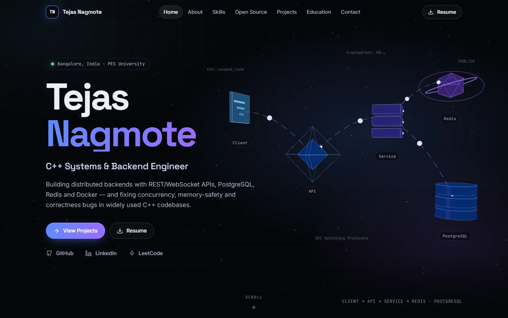
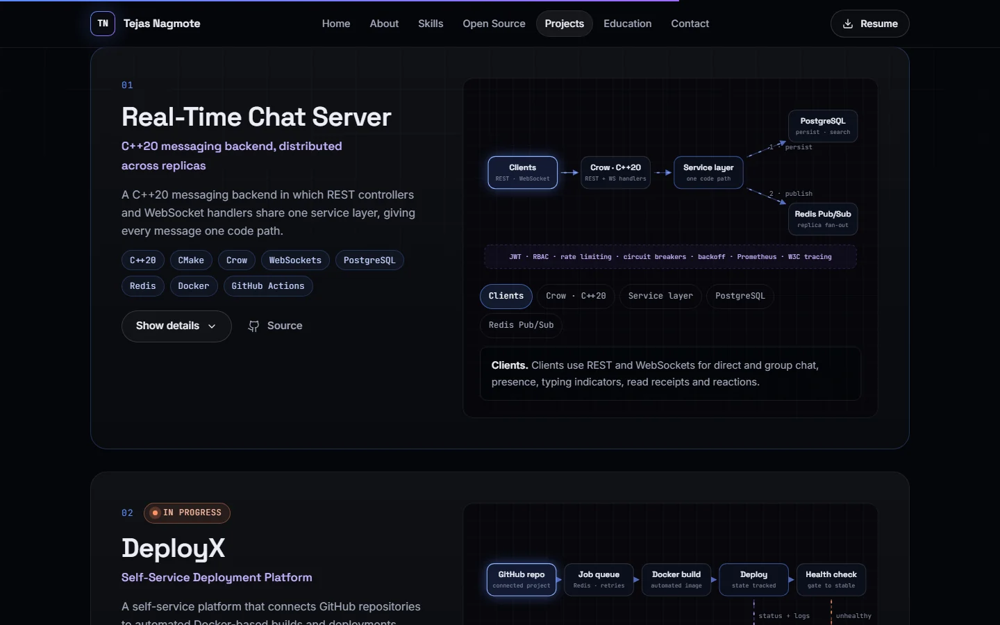
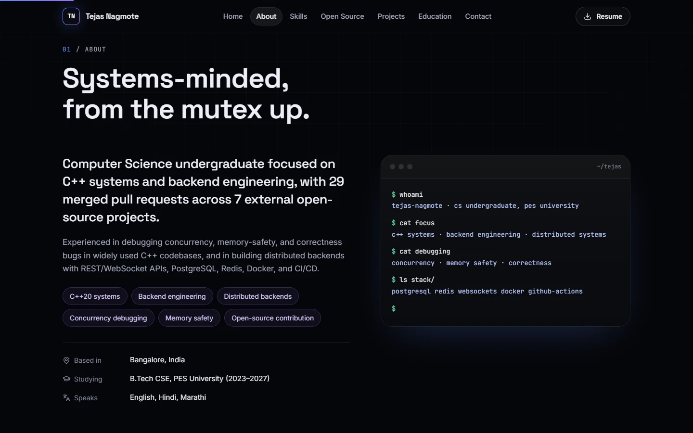
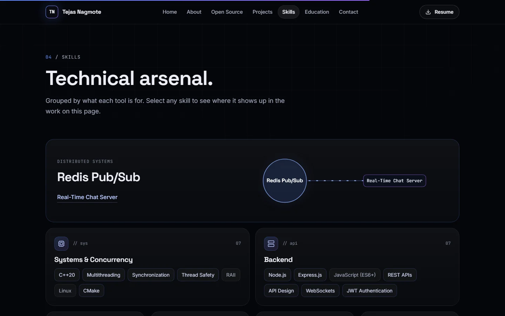
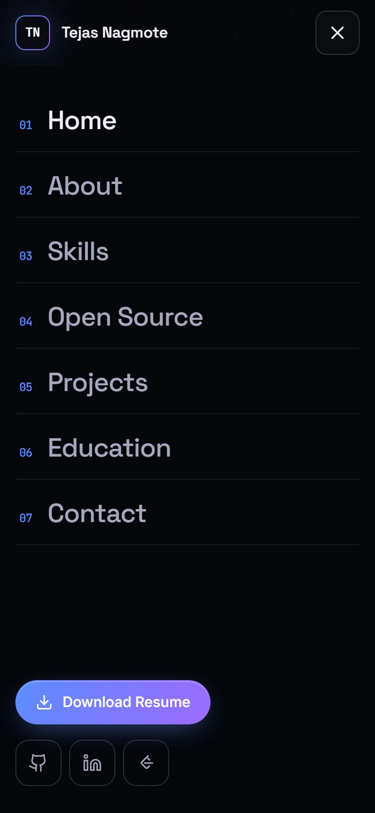

# Tejas Nagmote — Portfolio

Personal portfolio of **Tejas Nagmote**, a Computer Science undergraduate at PES University
focused on C++ systems and backend engineering.

**Live site:** https://devtejasx.github.io/tejas-nagmote-portfolio/



The hero is a small React Three Fiber scene of the path a request takes through a backend —
client → API → service → Redis / PostgreSQL — with animated links, travelling packets and pointer
parallax. The rest of the site covers open-source work, projects (each with an interactive
architecture diagram), skills, education and contact details. All content comes from the
resume in [`public/resume.pdf`](public/resume.pdf).

## Features

- **Interactive 3D hero** — low-poly nodes, animated dashed links, packets moving along the
  request path, particles, hover highlights and camera parallax.
- **Open-source section** — the 29 merged pull requests across 7 external projects from the
  resume, each linked to its PR on GitHub, with a per-project breakdown and a merge-date timeline.
- **Project cards** — expandable details and animated SVG architecture diagrams. Hover a
  component, or tap its button, to see what it does.
- **Responsive layouts** from 320 px phones to wide desktops, with a hamburger menu below 1024 px.
- **Accessible** — semantic landmarks and headings, a skip link, visible focus states, keyboard
  support for every control, a focus-trapped mobile menu, and `prefers-reduced-motion` support
  (movement is removed; the 3D scene renders a single still frame).
- **Graceful degradation** — no WebGL, a CPU-only WebGL renderer, a render error or a lost GPU
  context all fall back to an animated CSS/SVG version of the same graph. Each page section is
  wrapped in its own error boundary.
- **SEO** — title and description, canonical URL, Open Graph and Twitter cards, JSON-LD
  `Person` data, `robots.txt`, `sitemap.xml`, favicons and a web manifest.

## Screenshots

| Open source                                               | Projects                                            |
| --------------------------------------------------------- | --------------------------------------------------- |
|  |  |

| About                                         | Skills                                          |
| --------------------------------------------- | ----------------------------------------------- |
|  |  |

<p>
  
  
</p>

## Tech stack

| Area      | Choice                                                                                  |
| --------- | --------------------------------------------------------------------------------------- |
| Framework | React 19, TypeScript 6, Vite 8                                                          |
| 3D        | three.js 0.182, React Three Fiber 9, drei (`QuadraticBezierLine`, `PerformanceMonitor`) |
| Animation | Motion (`LazyMotion` + `m` components)                                                  |
| Styling   | Hand-written CSS with design tokens — no CSS framework                                  |
| Icons     | lucide-react, plus inline SVG brand marks                                               |
| Quality   | ESLint (typescript-eslint, react-hooks, jsx-a11y), Prettier, Vitest                     |
| Hosting   | GitHub Pages via GitHub Actions                                                         |

three.js is pinned to 0.182: later releases log a deprecation warning for `THREE.Clock`, which
React Three Fiber 9 still uses internally.

## Project structure

```
src/
├── animations/   Motion variants and the lazily loaded feature bundle
├── components/   Reusable UI: nav, buttons, tilt cards, counters, PR lists, diagrams
├── data/         Resume content (profile, skills, projects, open source) + tests
├── hooks/        Media queries, scroll-spy, idle detection
├── sections/     One component (and stylesheet) per page section
├── styles/       Fonts, design tokens, base styles, shared component styles
├── three/        The hero scene: layout data, nodes, links, particles, labels
├── utils/        WebGL capability probe, device profile, clipboard helper
├── App.tsx
└── main.tsx
```

### Architecture notes

- **Content is data.** Everything shown on the page lives in `src/data`, separate from the UI.
  `src/data/data.test.ts` pins the figures to the resume (29 PRs, 7 projects, per-project counts,
  only DeployX marked in progress) so a content edit cannot quietly drift from it.
  `pullRequests.ts` was generated from `gh search prs --author devtejasx --merged`, limited to the
  29 PRs merged by 2026-09-21.
- **The 3D scene is optional.** `three/HeroVisual.tsx` decides what to render. The scene chunk
  (three.js + R3F) is lazy-loaded and only mounted once the page is idle, and only on
  GPU-accelerated WebGL. Rendering pauses whenever the hero is off screen; low-end devices get
  fewer particles, a lower pixel ratio and a 30 fps cap, and any device whose frame rate drops
  is moved to the same settings.
- **Labels without extra React roots.** Node labels are ordinary DOM elements. A projector inside
  the canvas maps their 3D anchors to screen space each frame and writes a CSS transform, so
  moving labels never re-renders React.
- **Accessible diagrams.** Each architecture diagram is an SVG with a text summary, and every
  node also has a real button, so the explanations work with a keyboard, a touch screen or a
  screen reader — not just a mouse.

## Getting started

Requires Node.js 20.19 or newer (CI uses the version in `.nvmrc`).

```bash
npm install
npm run dev        # http://localhost:5173
```

| Script                 | What it does                              |
| ---------------------- | ----------------------------------------- |
| `npm run dev`          | Start the Vite dev server                 |
| `npm run build`        | Type-check and build to `dist/`           |
| `npm run preview`      | Serve the production build locally        |
| `npm run lint`         | ESLint, including accessibility rules     |
| `npm run typecheck`    | TypeScript project build without emitting |
| `npm test`             | Vitest data-integrity tests               |
| `npm run format:check` | Prettier check (`npm run format` to fix)  |

To see the 3D scene on a machine without GPU-accelerated WebGL (a VM or a headless browser,
for example), add `?3d=force` to the URL.

## Configuration

| Variable        | Default (in `.env`)                                    | Used for                                  |
| --------------- | ------------------------------------------------------ | ----------------------------------------- |
| `VITE_SITE_URL` | `https://devtejasx.github.io/tejas-nagmote-portfolio/` | Canonical, Open Graph, sitemap and robots |

Override it in `.env.local`, or in your host's environment, when deploying somewhere else. The
build uses a relative base path, so the same `dist/` works at a domain root or under a sub-path.

## Deployment

### GitHub Pages (current)

`.github/workflows/ci.yml` runs lint, the Prettier check, tests and the build on every push and
pull request. Pushes to `main` then deploy `dist/` to GitHub Pages. In a fork, enable it once
under **Settings → Pages → Source: GitHub Actions**.

### Vercel or Netlify

Import the repository, then use build command `npm run build` and output directory `dist`, and
set `VITE_SITE_URL` to the new domain (with a trailing slash). No other configuration is needed.

## Credits

- [three.js](https://threejs.org/), [React Three Fiber](https://github.com/pmndrs/react-three-fiber)
  and [drei](https://github.com/pmndrs/drei) — MIT
- [Motion](https://motion.dev/) — MIT
- [Lucide](https://lucide.dev/) icons — ISC
- [Inter](https://rsms.me/inter/), [Space Grotesk](https://github.com/floriankarsten/space-grotesk)
  and [JetBrains Mono](https://www.jetbrains.com/lp/mono/) via [Fontsource](https://fontsource.org/)
  — SIL Open Font License 1.1

The resume, project descriptions and other personal content belong to Tejas Nagmote.
