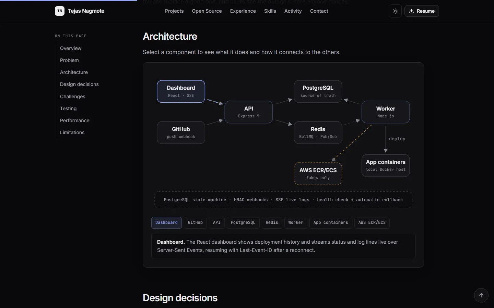
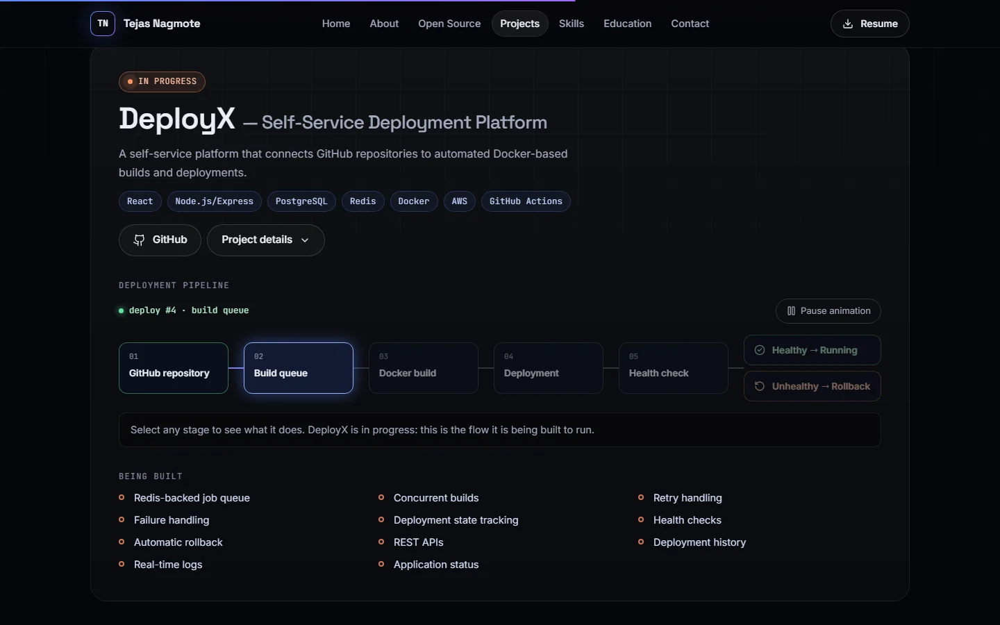
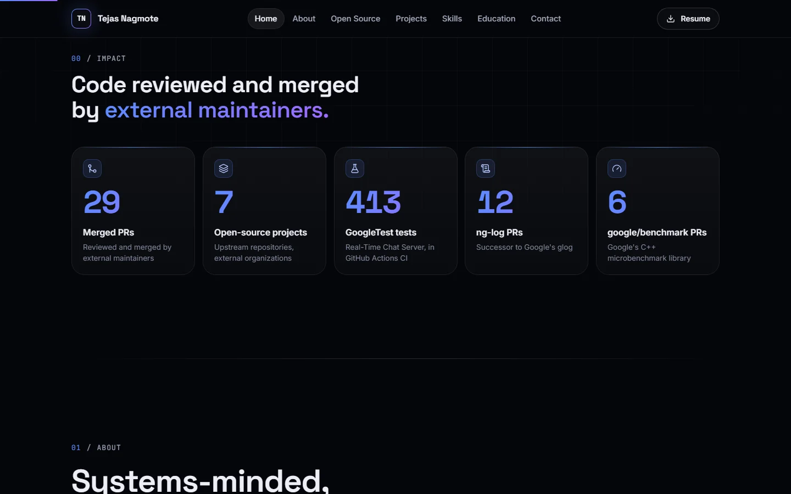
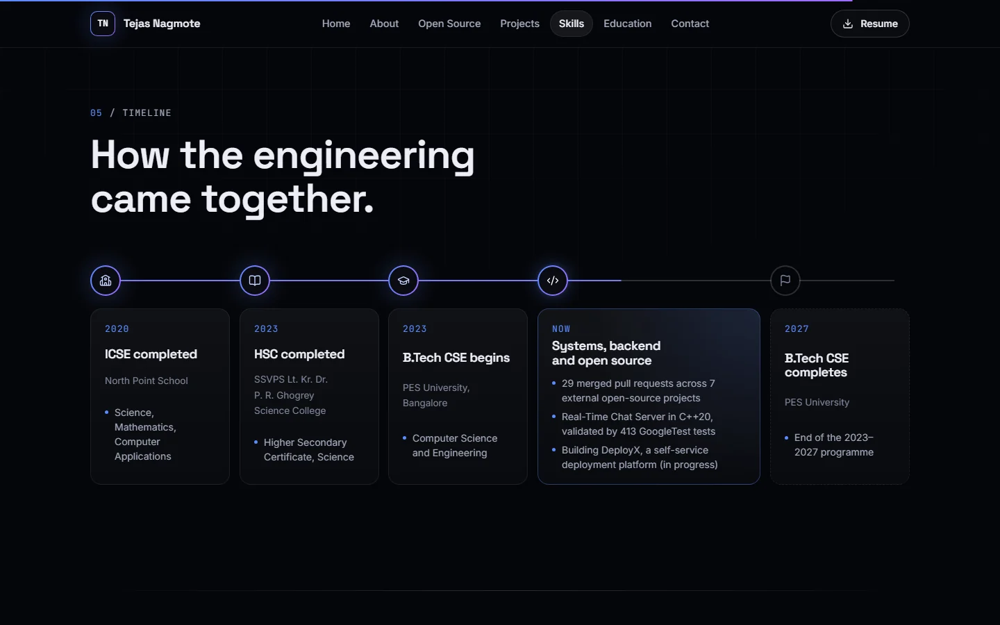
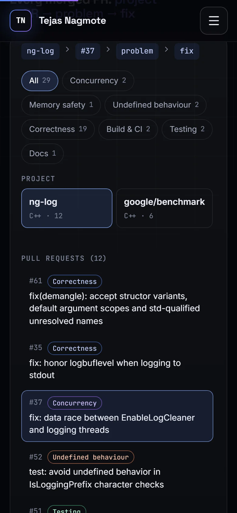

# Tejas Nagmote — Portfolio

Personal portfolio of **Tejas Nagmote**, C++ systems and backend engineer and Computer Science
undergraduate at PES University.

**Live site:** https://devtejasx.github.io/tejas-nagmote-portfolio/


The site is built to answer five questions in the first screens: who Tejas is (a C++ systems
and backend engineer), what he builds (backend and distributed systems), what sets him apart
(41 merged pull requests across 8 external open-source projects), his best project (a real-time
C++ chat server) and what he is building now (DeployX). The 3D visuals are diagrams of that
work rather than decoration: the hero is the chat server's message path, ending in Redis fanning
events out to other replicas.

Content comes from the resume in [`public/resume.pdf`](public/resume.pdf). The pull-request
explanations are paraphrased from each PR's own description on GitHub, and the CodeCompass and
ARISE cards from those repositories' READMEs.

## Sections

| Section            | What it shows                                                                                               |
| ------------------ | ----------------------------------------------------------------------------------------------------------- |
| Hero               | Role, one-line pitch, roles of interest, and a 3D distributed-system scene                                  |
| Impact             | 41 merged PRs · 8 projects · 413 GoogleTest tests · 13 ng-log PRs · 7 google/benchmark PRs                  |
| About              | Short summary and an at-a-glance card: role, focus, differentiator, featured and current project            |
| Open Source        | Contribution graph, featured ng-log and google/benchmark cards, and a project → PR → problem → fix explorer |
| Projects           | Real-Time Chat Server (3D architecture), DeployX (animated pipeline, in progress), REST API Testing Suite   |
| Skills             | Seven skill clusters; selecting a skill shows where it is used on the page                                  |
| Timeline           | ICSE 2020 · HSC 2023 · B.Tech 2023 · current work · 2027                                                    |
| Education, Contact | The B.Tech, then email, GitHub, LinkedIn, LeetCode and the resume                                           |

## Screenshots

| Open-source explorer                                        | Chat server architecture (3D)                                             |
| ----------------------------------------------------------- | ------------------------------------------------------------------------- |
|  |  |

| DeployX pipeline                                   | Impact                                          |
| -------------------------------------------------- | ----------------------------------------------- |
|  |  |

| Skills                                          | Timeline                                                |
| ----------------------------------------------- | ------------------------------------------------------- |
|  |  |

<p>
  
  
</p>

## Features

- **3D hero.** A React Three Fiber scene of the chat server's message path: client → REST/WebSocket
  → C++ service → PostgreSQL, and service → Redis → two backend replicas, with packets moving along
  each link and pointer parallax.
- **Open-source explorer.** A GitHub-style contribution graph of the 41 merge dates feeds a
  three-pane explorer: pick a project, then a PR, and read the problem and the fix. Filters group
  the PRs by kind (concurrency, memory safety, undefined behaviour, correctness, build, testing,
  docs). Every PR links to the merged PR on GitHub.
- **3D architecture view.** The chat server's architecture as an interactive scene: click a
  component, or use the buttons beneath it, to read what it does. Phones, machines without a GPU and
  anyone who prefers it get the same architecture as an SVG diagram.
- **Animated DeployX pipeline.** Repository → build queue → Docker build → deployment → health
  check, alternating between a healthy run and a rollback. It can be paused, never auto-plays under
  reduced motion, and is labelled as in progress.
- **Skills with evidence** instead of percentage bars, and a **scroll-drawn engineering timeline**
  that uses only dates the resume states.
- **Accessible.** Landmarks and a single heading outline, a skip link, visible focus, keyboard and
  touch access to every interactive view, a focus-trapped mobile menu, `aria-live` explanations, and
  `prefers-reduced-motion` support.
- **Graceful degradation.** No WebGL, CPU-only WebGL, a render error or a lost GPU context fall
  back to SVG versions of the same diagrams; each page section has its own error boundary.
- **SEO.** Title, description, canonical URL, Open Graph and Twitter cards, JSON-LD `Person` data,
  `robots.txt`, `sitemap.xml`, favicons and a web manifest.

## Tech stack

| Area      | Choice                                                                                  |
| --------- | --------------------------------------------------------------------------------------- |
| Framework | React 19, TypeScript 6, Vite 8                                                          |
| 3D        | three.js 0.182, React Three Fiber 9, drei (`QuadraticBezierLine`, `PerformanceMonitor`) |
| Animation | Motion (`LazyMotion` + `m` components)                                                  |
| Styling   | Hand-written CSS with design tokens, no CSS framework                                   |
| Icons     | lucide-react, plus inline SVG brand marks                                               |
| Quality   | ESLint (typescript-eslint, react-hooks, jsx-a11y), Prettier, Vitest                     |
| Hosting   | GitHub Pages via GitHub Actions                                                         |

three.js is pinned to 0.182: later releases log a deprecation warning for `THREE.Clock`, which
React Three Fiber 9 still uses internally.

## Performance

- The main bundle is about 131 kB gzipped. three.js and React Three Fiber (about 245 kB gzipped)
  live in a separate chunk that downloads only when a 3D scene will actually run.
- The hero scene starts after the page is idle; the architecture scene loads as it nears the
  viewport. Both stop rendering when scrolled out of view.
- CPU-only WebGL renderers get the SVG versions, low-end devices get fewer particles, a lower pixel
  ratio and a 30 fps cap, and any device that cannot hold its frame rate is moved to the same.
- Fonts are self-hosted, latin subset only. Lighthouse on the production build: 100 for
  performance, accessibility, best practices and SEO on desktop; 87–93 for performance and 100 for
  the rest on mobile.

## Project structure

```
src/
├── animations/   Motion variants and the lazily loaded feature bundle
├── components/   Nav, buttons, tilt cards, counters, architecture views, DeployX pipeline
│   └── oss/      Contribution graph and pull-request explorer
├── data/         All content: profile, skills, projects, PRs and their problem/fix notes + tests
├── hooks/        Media queries, scroll-spy, idle detection
├── sections/     One component (and stylesheet) per page section
├── styles/       Fonts, design tokens, base styles, shared component styles
├── three/        3D scenes: shared graph nodes and links, label projector, hero and architecture
├── utils/        WebGL capability probe, device profile, clipboard helper
├── App.tsx
└── main.tsx
```

### Architecture notes

- **Content is data.** Everything on the page lives in `src/data`. `data.test.ts` pins it to the
  resume: the five impact figures, the per-project PR counts, that only DeployX is in progress, that
  every merged PR has a problem/fix note (and nothing else does), that every skill-evidence entry
  names a real project, and that the timeline uses only dates from the education data.
- **One graph, two scenes.** `three/graph.tsx` holds the node and link components; the hero and the
  architecture view are different layouts of the same pieces. Node labels are plain DOM elements
  positioned each frame by a projector, so they never re-render React.
- **Every interactive view has a non-3D path.** The architecture, explorer and pipeline are all
  buttons first; the 3D and animation sit on top.

## Getting started

Requires Node.js 20.19 or newer (CI uses the version in `.nvmrc`).

```bash
npm install
npm run dev        # http://localhost:5173
```

| Script                 | What it does                              |
| ---------------------- | ----------------------------------------- |
| `npm run dev`          | Start the Vite dev server                 |
| `npm run build`        | Type-check and build to `dist/`           |
| `npm run preview`      | Serve the production build locally        |
| `npm run lint`         | ESLint, including accessibility rules     |
| `npm run typecheck`    | TypeScript project build without emitting |
| `npm test`             | Vitest data-integrity tests               |
| `npm run format:check` | Prettier check (`npm run format` to fix)  |

On a machine without GPU-accelerated WebGL (a VM or a headless browser), add `?3d=force` to the
URL to see the 3D scenes anyway.

## Configuration

| Variable        | Default (in `.env`)                                    | Used for                                  |
| --------------- | ------------------------------------------------------ | ----------------------------------------- |
| `VITE_SITE_URL` | `https://devtejasx.github.io/tejas-nagmote-portfolio/` | Canonical, Open Graph, sitemap and robots |

Override it in `.env.local`, or in your host's environment, when deploying somewhere else. The
build uses a relative base path, so the same `dist/` works at a domain root or under a sub-path.

## Deployment

### GitHub Pages (current)

`.github/workflows/ci.yml` runs lint, the Prettier check, tests and the build on every push and
pull request. Pushes to `main` then deploy `dist/` to GitHub Pages. In a fork, enable it once
under **Settings → Pages → Source: GitHub Actions**.

### Vercel or Netlify

Import the repository, then use build command `npm run build` and output directory `dist`, and
set `VITE_SITE_URL` to the new domain (with a trailing slash). No other configuration is needed.

## Credits

- [three.js](https://threejs.org/), [React Three Fiber](https://github.com/pmndrs/react-three-fiber)
  and [drei](https://github.com/pmndrs/drei): MIT
- [Motion](https://motion.dev/): MIT
- [Lucide](https://lucide.dev/) icons: ISC
- [Inter](https://rsms.me/inter/), [Space Grotesk](https://github.com/floriankarsten/space-grotesk)
  and [JetBrains Mono](https://www.jetbrains.com/lp/mono/) via [Fontsource](https://fontsource.org/):
  SIL Open Font License 1.1

The resume, project descriptions and other personal content belong to Tejas Nagmote.
